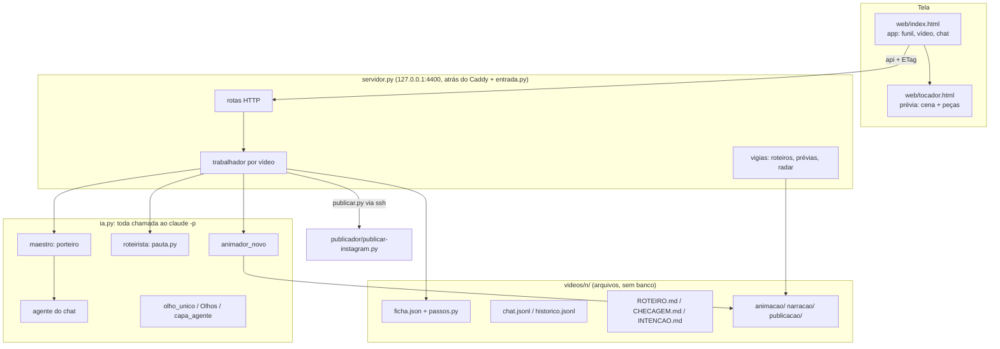
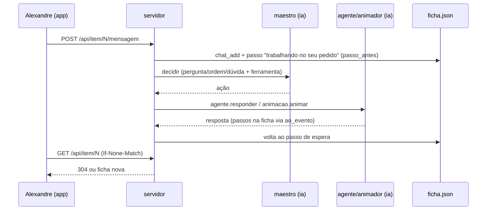

# Mapa do estúdio v2

> Gerado pelo Cartographer em 25/10/2026 (4 leitores em paralelo). Os comentários do código são datados e citam a frase
> do Alexandre ("ele:") que motivou cada regra: leia antes de mudar comportamento.

## Visão geral



**Etapas:** Pauta → Roteiro e voz → Animação → Aguardando → Publicado.

O caminho é conduzido pelo programa, sem IA, seguindo `passos.py`. A IA entra em três papéis:
- **entender:** o maestro;
- **criar:** roteirista, animador, capa e legenda;
- **conferir:** segunda opinião, fontes e Olhos.

## Estrutura

```
estudio-v2/
├── servidor.py        rotas, trabalhador por vídeo, vigias, retomar ao religar, aprovar/publicar
├── estudio.py         base: fichas (mexe_ficha valida pelo mapa), chat, blocos do roteiro, funil (cartões em cache),
│                      gasto, prazo/mata, na_vps/para_vps
├── passos.py          o mapa de passos (tabela): etapas, esperas, botões, religar, confere
├── ia.py              chamar(): prazo, gasto, uso da conta, erro, ferramentas com caminho, ao_evento; json_de()
├── visao.py           quadro(), rostos(), maior(), nitidez(), melhor_rosto() (YuNet)
├── entrada.py         login Face ID/senha (V2_ENTRADA=1 na VPS)
├── maestro.py         porteiro: decide pergunta/ordem/dúvida e a ferramenta
├── agente.py          agente do chat (trabalhar com passos na tela; responder; material/baixar)
├── pauta.py           baixa, transcreve e escreve o roteiro; reescrever, propor direções, versões
├── material.py        material que não é vídeo (carrossel, pdf, página)
├── monitor.py         segunda opinião do roteiro (desligada por padrão: OPINIAO_LIGADA=False)
├── fontes.py          conferência das fontes da CHECAGEM (aceita link solto)
├── voz.py             grava a voz por bloco (hash do texto: só regrava o que mudou)
├── animacao.py        orquestra a animação: animar (2 tentativas, só o animador novo), régua, página da prévia,
│                      codigo_perigoso, tamanhos das imagens, rostos dos takes
├── animador_novo.py   animador (uma chamada, imagens no pedido): primeira, ajustar, revisar_e_consertar, opus
├── olho_unico.py      o olho que acompanha o vídeo (prévia, localizar pedido, enquadramento, imagem em faixa)
├── olhos_ponte.py     ponte para ../olhos (espectador do vídeo final)
├── capa.py            capas: capa_agente → capa_molde → agente antigo; escolher
├── capa_agente.py     capa com foto real do take, conferida e reenquadrada pelos Olhos (mover_y)
├── capa_molde.py      capa sem IA do molde "Fomos conferir"
├── render.py          vídeo final (Playwright, 4 navegadores, 30 fps) e prévia em vídeo (720p)
├── legenda_post.py    legenda do Instagram (portão de hashtags)
├── publicar.py        publica pela VPS (ssh); limpar depois de publicar
├── stories.py, canal.py, numeros.py   Story, canal do WhatsApp, métricas do post
├── radar.py           radar de pautas (outro processo)
├── web/               app, tocador, peças (pecas/*.js), sons, fontes, logos, morphdom.min.js
├── regras/            prompts dos agentes (AGENTE, ANIMADOR, ROTEIRISTA, CAPA, LEGENDA, MOLDE-*, IDENTIDADE...)
├── ferramentas/       acervo, baixar, saida_casa, transcrever, ver, regua, instalar, levar_vps, saude, avisar...
├── publicador/        publicar-instagram, metricas, comentarios(_whatsapp), fundador
├── testes/            tudo.py (bateria) + testes tipo A e em cópia
├── radar/             dados do radar, acervo.db, memória da página (fora do git)
└── videos/<n>/        um vídeo por pasta (fora do git)
```

## Módulos

### Servidor e estado

**servidor.py** (~1700 linhas):
- **Rotas e trabalho:**
  - `H` (rotas);
  - `trabalhador` e `garantir` (uma thread por vídeo);
  - `desiste`: na 2ª falha do mesmo pedido, responde no chat e volta à espera.
- **Atendimento:**
  - `maestro_atende`, `roteiro_atende`, `aprovado_atende`;
  - `animar`, que retoma `animacao_pendente`;
  - `gerar_final`;
  - `publicar_agora`, com canal e Story marcados como `pos_publicar`.
- **Religar:** `retomar` e `conserta_fora_do_mapa`.
- **Tela:** `item_json`, com ETag.
- **Vigias:**
  - `vigia_roteiros`;
  - `vigia_previas`, só para vídeos ativos (mexidos em 48 h ou abertos há menos de 30 min), o mais novo primeiro;
  - `vigia_radar`.
- **Proteções:** `_mesmo_site` recusa outro Host ou Origin, e `_corpo` tem teto de tamanho.

**estudio.py:**
- `ler_ficha` e `mexe_ficha`, que trava e valida pelo mapa;
- `chat`, que pula linha cortada; `chat_add`; `pendentes`;
- `blocos` e `falas_alheias`, que aceita fala conferida em outro roteiro;
- `funil(etapa)` e `cartao`, com cache por data de modificação;
- `anota_gasto`;
- `prazo(proc, s)` e `mata(proc)`.

**passos.py:** `PASSOS`, `TRABALHANDO`, `religar`, `confere`, `botoes`.

Atenção: o servidor ainda tem constantes de passo próprias (GRAVANDO, ANIMANDO...). Ao mudar o nome de um passo, mude nos dois lugares.

### IA

**ia.py** é o único lugar que roda `claude -p`.
- `chamar(entrada, quem, modelo, num, limite, ferramentas, permitidas, modo, cwd, registro, dirs, ao_evento)` → `(texto, uso)`.
- Ferramentas de arquivo sempre com caminho:
  - `com_caminho`: a pasta do trabalho mais regras, web e referencias;
  - `negadas`: regras/ só leitura.

Agentes que passam por ele:
- maestro (sonnet);
- agente do chat (opus/sonnet; `ao_evento` põe os passos na tela);
- roteirista (opus, com WebSearch, WebFetch e Read);
- animador (opus);
- capas e Olhos;
- segunda opinião e fontes;
- legenda, canal e tradução;
- radar e robô de comentários.

### Animação

**`animacao.animar`** chama `animador_novo.primeira`, `ajustar` ou `revisar_e_consertar`, com 2 tentativas:
- se falhar duas vezes, a cena de antes volta e o erro sobe;
- "O ROTEIRO FOI REFEITO" gera uma cena nova do zero.

**Primeira animação:**
1. Régua, Olhos, editor e olho único olham em paralelo.
2. Um conserto só.
3. O olho único olha de novo. O que sobra vira aviso `olhos`, com o botão "Consertar estes avisos".

**Régua (`_regua_inteira`)** mede:
- `ver.regua`, em 3 trechos;
- tela vazia e tela parada;
- faixa preta;
- código perigoso, que conta como erro.

**Prévia:**
- `animacao.pagina` preenche o `web/tocador.html` ({{CENA}}, e {{DADOS}} com `tamanhos`, `rostos`, `tarjas`...);
- `render.previa_video` grava o MP4 por versão (md5 da página, da capa e das peças).

### Tela (web/)

**index.html:**
- endereços por hash (`#/etapa/X`, `#/item/N`);
- `api()` com ETag: num 304, usa a resposta guardada;
- `atualizar()` a cada 2 s (`/api/funil?etapa=` e `/api/item/N`);
- redesenho com morphdom (`redesenhaEmVolta`): a prévia nunca sai da página e nada muda com o dedo na tela;
- ditado pela Groq, com vigia de microfone mudo;
- botões pelo mapa (`podeApertar`).

**tocador.html:**
- `T.*`:
  - tempo da fala e `T.som`;
  - `T.selo`, `T.take`, `T.fotos`, `T.documento`, `T.carimbos`, `T.fecho`, `T.plenario`, `T.assinatura`, `T.capa`;
  - `T.colagem.*` e `T.numeros.*`;
- encolhe texto fora da zona segura;
- `window.__erroCena` trava a aprovação e o render;
- usa GSAP 3.14.2 do jsdelivr.

**pecas/:**
- verdadometro, assinatura, take, seguir;
- fotos: a foto deitada entra inteira no alto, pelo tamanho real;
- documento, carimbos, fecho, plenario, colagem, numeros, brasil-uf.

### Capa

`capa.fazer` tenta, nesta ordem:
1. **`capa_agente`:**
   - o Sonnet escolhe 2 opções;
   - `visao.melhor_rosto` tira a foto do take;
   - `svg` monta a capa;
   - os Olhos conferem; se pedirem `mover_y`, a foto é reenquadrada e conferida de novo;
   - o aviso fica na opção.
2. `capa_molde`.
3. O agente antigo.

Medidas: o queixo vai até y 820 e o degradê começa em 720 (com aspas). `capa.escolher` liga a capa viva.

### Publicação e operação

**Publicação:**
- `publicar.py`: ssh para `publicador/publicar-instagram.py`; a trava de duplicata é gravada logo após o `media_publish`;
- `stories.py`, `canal.py`, `legenda_post.py`, `numeros.py`;
- `publicador/metricas.py` (cron 10h) e `publicador/comentarios_whatsapp.py` (cron a cada 5 min).

**ferramentas/:**
- **Downloads:**
  - `acervo.py`: o que já baixamos, em FTS5 (`buscar`, `trazer`);
  - `baixar.py`: só link http(s) da internet;
  - `saida_casa.py`: yt-dlp pela casa, pela IPRoyal ou direto, com `--ignore-config` e `--`.
- **Conferência:** `ver.py`, `regua.py`, `celular.py`.
- **Instalação:**
  - `instalar.py`: o único jeito de registrar uma mudança;
  - `levar_vps.sh` e `levar_vps_remoto.sh`: testam o candidato, esperam o estúdio ficar livre, trocam, conferem e voltam sozinhos se falhar;
  - `prova_vps.sh`.
- **Vigilância:**
  - `saude.py` (cron a cada 30 min: inclui vídeos parados, erros do estúdio e disco por GB livres) e `avisar.py`;
  - `tunel_db.py`, `atualizar_ytdlp.sh`.
- **Conteúdo:** `fotos_livres.py`, `preparo_microdoc.py`, `trilha.py`, `fluidez.py`, `memoria.py`, `transcrever.py`, `narrador.py`, `portao.py`, `fal_cliente.py`.

**testes/tudo.py:**
- `RAPIDOS`, sem IA;
- `--completo` acrescenta `NA_COPIA`, rodado numa cópia do gabarito;
- cada rodada usa um TMPDIR próprio.

## Fluxos



**Entrega:**
1. Na cópia local: `instalar.py "<nome>" "<palavras dele>" --completo`.
2. `levar_vps.sh` leva para a VPS 204:
   - pasta `/srv/kitebiz/projetos/conteudo/estudio-v2`;
   - serviço `newsbr360-estudio-v2`;
   - registro em `instalacoes.jsonl`.

## Convenções
- Toda escrita de ficha passa por `E.mexe_ficha`. JSON é gravado com `E._grava` (atômico).
- Todo comentário é datado, com a frase dele e o plano aprovado. Todo registro (`instalar.py`) leva a autorização nas palavras dele.
- Chamadas de IA só por `ia.chamar`. Rostos e quadros só por `visao`.
- Teste novo de lógica é "Tipo A" (pasta temporária, sem IA) e entra em `RAPIDOS`.

## Cuidados
- **Acesso:** o servidor só escuta em 127.0.0.1. De fora, só pelo Caddy (admin.newsbr360.com), com login. Pedido de 127.0.0.1 sem X-Forwarded-For passa sem login, porque é o caminho das ferramentas internas.
- **A cena é código da IA** e roda na mesma página do painel. `codigo_perigoso` bloqueia fetch, parent, cookie e endereço externo. O iframe ainda não tem `sandbox`.
- **Publicação:** "publicando" nunca recomeça sozinho. Um religar nesse passo vira "publicação interrompida".
- **Religar:**
  - no meio de uma animação, retoma `animacao_pendente`;
  - o pedido do Reabrir fica em `pedido_guardado`.
- **Prévia:** a prévia em vídeo é só para vídeos ativos. A prévia ao vivo (iframe) depende do GSAP no jsdelivr.
- **Sobras:**
  - `regras/PUBLICO.md` cita `ferramentas/publico.py`, que não existe mais;
  - `ferramentas/voz/metodo.py` é sobra de outro projeto.
- **Backup:** `olhos/` (em `conteudo/olhos`) fica fora do git e do backup diário até ele autorizar. A lista do `.venv` está em `requirements-vps.txt`.

## Onde mexer

| Para mudar | Onde |
|---|---|
| Pedido do chat mal entendido | `maestro.py` (PEDIDO_ROTEIRO e PEDIDO) e `regras/AGENTE.md` |
| Animação | `regras/ANIMADOR.md`, `animador_novo.py`, uma peça em `web/pecas/` e `tocador.html` (T.*) |
| Régua e conferência | `animacao._regua_inteira`, `ferramentas/regua.py`, `olho_unico.PREVIA`, `animador_novo.EDITOR` |
| Capa | `capa_agente.py` (CAPA_ROSTO, svg, CONFERE) e `regras/CAPA.md` |
| Novo passo ou botão | `passos.py`, `servidor.py` (rota e ACOES) e `web/index.html` (podeApertar) |
| Nova chamada de IA | `ia.chamar`, nunca subprocess direto |
| Publicação | `publicar.py`, `publicador/publicar-instagram.py` e `regras/LEGENDA.md` |
| Alertas | `ferramentas/saude.py` (ITENS) e `avisar.py` |
